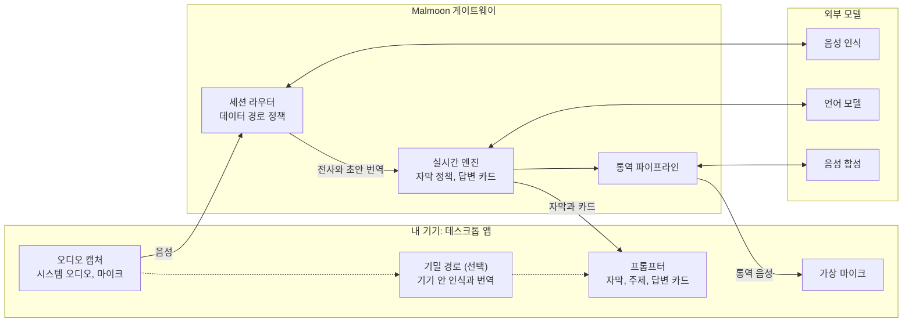

# 시스템 아키텍처

> 기준일 2026-11-12. 버전과 가격은 이 날짜에 확인한 값이다.

## 결정 요약

| 영역 | 결정 | 이유 |
| --- | --- | --- |
| 데스크톱 | Rust와 GPUI. macOS를 먼저 내고 Windows를 잇는다 | 통화 앱 옆에서 가볍게 돌고, 오디오 처리와 화면이 한 프로세스에 있다 |
| 웹 | React 19 | 디자인 시스템의 기준인 Astryx가 React 전용이다 |
| 모바일 | React Native (Expo) | 웹과 언어, 도구, 인력을 공유한다 |
| 공유 코어 | Rust 크레이트 `malmoon-core` | 세션 프로토콜과 자막 안정화 로직을 한 번만 구현한다 |
| 게이트웨이 | Rust (axum, tokio) | 프로토콜 타입을 코어와 공유한다 |
| 음성 인식 | Soniox 기본, ElevenLabs 예비 | [모델 비교](05-stt-comparison.md) 참고 |
| 언어 모델 | 실시간은 Claude Haiku 5.5, 회의 후는 Claude Sonnet 5.5 | 실시간은 속도, 회의 후는 품질이 우선이다 |
| 디자인 시스템 | Astryx 기반, 플랫폼별 생성 | [디자인 시스템](06-design-system.md) 참고 |

## 전체 구조



평소에는 음성이 게이트웨이를 거쳐 인식 모델로 가고, 결과는 실시간 엔진을 거쳐 프롬프터로 돌아온다.
기밀 경로를 켜면 인식과 번역이 기기 안에서 끝나고 서버로 음성을 보내지 않는다.

## 클라이언트

### 역할 분담

| 클라이언트 | 역할 | 출시 단계 |
| --- | --- | --- |
| 데스크톱 (GPUI) | 회의 중 프롬프터 오버레이, 캡처, 회의 기록 | 1단계 macOS, 2단계 Windows |
| 웹 (React) | 로그인과 결제, 회의 리포트, 팀 관리 콘솔, 보조 화면 | 1단계 최소 기능, 2단계 보조 화면, 3단계 콘솔 |
| 모바일 (React Native) | 대면 회의, 리포트 열람, 보조 화면 | 4단계 |

### 공유 코어

`malmoon-core`는 입출력이 없는 순수 로직으로 만든다. 스레드, 네트워크, 오디오 장치에 의존하지 않는다.

- 담는 것: 세션 프로토콜 메시지, 자막 안정화(초안과 확정본 교체), 용어집 적용, 데이터 모델
- 데스크톱: 크레이트를 그대로 쓴다.
- 웹: WebAssembly로 빌드해 쓴다.
- 모바일: UniFFI로 바인딩한다. `uniffi-bindgen-react-native`는 아직 프로덕션 사용을 권하지 않는다고 밝히므로, 4단계 착수 시점에 다시 평가한다.

### 데스크톱 앱이 GPUI로 가능한가

가능하다. 다만 오버레이는 GPUI만으로 끝나지 않고 OS별로 300줄 안팎의 네이티브 보완 코드가 필요하다.

| 요구 | GPUI 지원 | 보완 방법 |
| --- | --- | --- |
| 항상 위, 모든 화면 공간, 포커스 안 뺏기 (macOS) | 지원 (`PopUp` 창) | 비활성화 시 숨김만 네이티브 호출로 끈다 |
| 항상 위, 포커스 안 뺏기 (Windows) | 부분 지원. 클릭하면 창이 활성화된다 | 창 스타일과 메시지 처리를 네이티브로 바꾼다 |
| 클릭 통과 | 미지원 | 창 핸들로 OS API를 호출한다 |
| 투명, 블러 배경 | 지원 | 없음 |
| 창 이동과 디스플레이 간 배치 | 생성 시에만 지원 | 이동은 네이티브 호출 |
| 한중일 글꼴과 입력기 | 지원. 알려진 버그가 있다 | 아래 위험 표 참고 |
| 접근성 | 지원 (AccessKit, 2026년 5월 도입) | 요소마다 역할과 ID를 지정한다 |

GPUI 밖에서 채우는 부분은 다음 크레이트를 쓴다.

| 필요 | 크레이트 |
| --- | --- |
| UI 컴포넌트 기반 | gpui-component (Apache-2.0) |
| 시스템 오디오 캡처 | macOS는 objc2-core-audio(프로세스 탭), Windows는 wasapi(프로세스 루프백) |
| 에코 제거, 인코딩, 리샘플링 | sonora, opus, rubato |
| 네트워크 | tokio 런타임을 GPUI 실행기 옆에 따로 둔다 |
| 트레이 아이콘, 전역 단축키 | tray-icon, global-hotkey |
| 자동 업데이트와 서명 | Velopack |
| 크래시 리포트 | sentry, minidumper |
| 로컬 암호화 저장 | rusqlite (SQLCipher) |
| 자격 증명 | GPUI 내장 기능 또는 keyring |
| 딥링크 | macOS는 GPUI 내장, Windows는 레지스트리 등록과 단일 인스턴스 전달 |

### GPUI 선택의 위험

| 위험 | 내용 | 대응 |
| --- | --- | --- |
| 버전 안정성 | crates.io 릴리스가 1년간 없고 1.0 이전이라 호환성이 자주 깨진다 | git 리비전을 고정하고, GPUI를 얇은 자체 UI 계층으로 감싼다. 업그레이드 시간을 일정에 넣는다 |
| 입력기 | 포커스를 받지 않는 패널에서 조합 입력이 실패하는 이슈가 열려 있다 | 텍스트 입력은 일반 창에서 받는다. 한국어 입력기 시험을 0단계에 넣는다 |
| 한국어 줄바꿈 | 어절 단위로 끊는 옵션이 없다 | 자막 줄을 자체 분절 로직으로 미리 끊는다 |
| 가변 글꼴 | 굵기 축이 무시되는 이슈가 열려 있다 | 굵기별 정적 글꼴 파일을 싣는다 |
| 화면 공유 감지 | macOS에는 공개 API가 없다 | 단축키 한 번으로 보조 화면에 넘기는 것을 기본으로 하고, 자동 감지는 보조로 둔다 |
| 라이선스 | Zed의 `ui`, `theme` 크레이트는 GPL이다 | 복사하지 않는다. gpui-component만 쓴다 |

## 실시간 파이프라인

1. 마이크와 시스템 오디오를 두 채널로 따로 받는다. 채널이 다르므로 나와 상대가 구분된다.
2. 16kHz Opus로 인코딩해 게이트웨이에 보낸다.
3. 인식 엔진이 부분 결과와 초안 번역을 돌려준다. 초안은 흐리게 표시한다.
4. 문장이 확정되면 언어 모델이 용어집과 회의 맥락으로 번역을 다듬어 교체한다.
5. 질문이 감지되면 질문이 끝나기 전에 답변 카드 생성을 시작한다.
6. 회의가 끝나면 요약, 액션 아이템, 코칭을 만든다.

### 지연 목표

목표는 벤더 수치에서 역산한 값이고, 0단계 기술 검증에서 실측해 확정한다.

| 지표 | 목표 |
| --- | --- |
| 원문 자막 | 발화 후 0.3초 안에 부분 결과 (중앙값) |
| 번역 자막 초안 | 발화 후 1초 안 |
| 번역 확정본 | 절이 끝난 뒤 1~3초. 한국어는 동사가 문장 끝에 와서 구조적 하한이 있다 |
| 답변 카드 | 질문이 끝난 뒤 1초 안에 첫 문장 |
| 음성 통역 | 절이 끝난 뒤 1~2초 안에 첫 음성 |

## 데이터 경로

사용자와 관리자가 세 경로 중에서 고른다.

| 경로 | 음성 | 대화록 | 대상 |
| --- | --- | --- | --- |
| 표준 | 게이트웨이를 거쳐 인식 모델로 간다. 저장하지 않는다 | 기기에 저장하고, 공유할 때만 서버에 올린다 | 개인 |
| 무보존 | 표준과 같다. 모델 벤더와 무보존 계약을 맺는다 | 서버에 남기지 않는다 | 팀 |
| 기밀 | 기기를 떠나지 않는다 | 기기에만 저장한다 | 보안 요건이 높은 조직 |

기밀 경로는 Mac에서 Apple의 온디바이스 인식과 번역을 쓴다. Windows 노트북에서는 실시간 품질이 부족할 수 있다.

## 구성 요소별 판단

| 구성 요소 | 선택 | 구축과 도입 |
| --- | --- | --- |
| 오디오 캡처 | macOS Core Audio 프로세스 탭, Windows 프로세스 루프백 | 구축 |
| 음성 인식 | Soniox 실시간 모델, 예비는 ElevenLabs Scribe | 도입 |
| 번역 | 인식 엔진의 초안과 언어 모델 다듬기 | 표시 정책은 구축, 모델은 도입 |
| 실시간 지원 | Claude Haiku 5.5, 프롬프트 캐시 | 구축 |
| 사후 처리 | Claude Sonnet 5.5 | 구축 |
| 음성 통역 | 인식, 번역, 복제 음성 합성의 연쇄 | 조합 구축 |
| 가상 마이크 | macOS HAL 플러그인, Windows 서명 드라이버 | 라이선스 구매 또는 구축 |
| 인증과 관리 | 관리형 데이터베이스와 인증, SSO 전문 서비스 | 도입 |
| 평가 인프라 | 지연 측정 도구, 한영 혼용 평가 세트 | 구축 |

## 원가

회의 1시간의 변동비는 약 $0.4~0.5이고, 음성 통역 20분을 포함하면 $0.7~0.85다.

| 항목 (회의 1시간) | 비용 (USD) |
| --- | --- |
| 음성 인식과 초안 번역 | 0.24~0.36 |
| 실시간 지원 20회 | 0.04 |
| 사후 요약과 코칭 | 0.11 |
| 음성 통역 20분 추가 | 0.30~0.36 |

가정은 인식 스트림 두 개, Haiku 5.5 호출 20회, Sonnet 5.5 사후 호출 1회다.

## 저장소 구조

```text
malmoon/
├── design/                디자인 시스템의 원천
│   ├── theme/             Astryx defineTheme으로 쓴 Malmoon 테마
│   ├── contracts/         제품 전용 컴포넌트 계약
│   ├── icons/             단색 SVG
│   └── fonts/             Pretendard
├── tools/
│   └── design-build/      추출기와 생성기 (tokens.json, contracts.json, Rust, TS)
├── third_party/
│   └── astryx/            고정 커밋에서 가져온 변환 스크립트 (MIT)
├── crates/
│   ├── malmoon-core/      세션 프로토콜, 자막 안정화, 줄바꿈, 데이터 모델
│   ├── malmoon-audio/     캡처, 에코 제거, 인코딩
│   ├── malmoon-tokens/    생성된 Rust 토큰과 속성 타입
│   └── malmoon-ui/        GPUI 컴포넌트
├── apps/
│   ├── desktop/           GPUI 앱
│   ├── web/               React 앱 (Astryx)
│   ├── mobile/            React Native 앱
│   └── gateway/           실시간 게이트웨이
├── packages/
│   ├── tokens/            생성된 TS 토큰과 속성 타입
│   ├── ui-native/         React Native 컴포넌트
│   └── core-js/           코어의 WebAssembly, JSI 바인딩
└── docs/
```

## 0단계에서 검증할 기술 과제

- GPUI 오버레이: 전체 화면 회의 창 위 표시, 클릭 통과, 한국어 입력, 초당 30회 자막 갱신
- 지연 실측: 캡처부터 자막 표시까지의 중앙값과 95퍼센타일
- 인식 품질: 한영 혼용과 억양 영어에 대한 Soniox와 ElevenLabs 비교
- 토큰 생성기: Astryx 테마에서 Rust 토큰을 만드는 시제품
