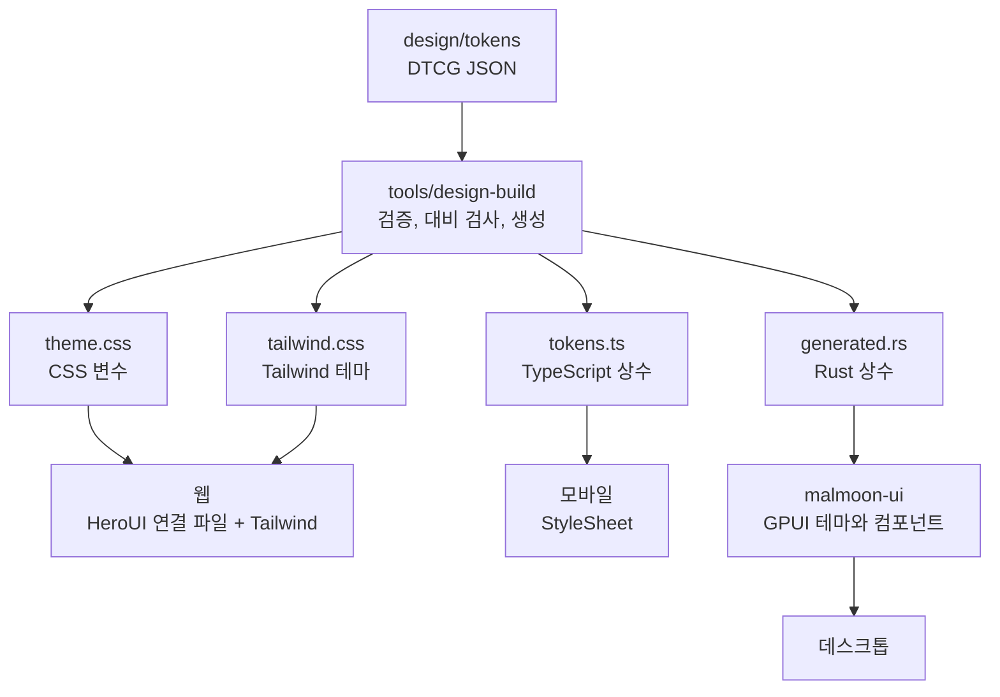

# 디자인 시스템 아키텍처

> 기준일 2026-11-13. 토큰 파이프라인과 세 플랫폼의 토큰 사용은 저장소에 구현돼 있고 `mise run check`가 검증한다.
> 컴포넌트 범위와 모바일 UI 키트는 계획이다.

## 결론

Malmoon이 소유한 토큰 파일 하나가 원천이고, 세 플랫폼은 거기서 생성한 파일을 쓴다.

- **공유하는 것은 컴포넌트 코드가 아니라 결정이다.** 토큰의 이름과 값을 공유하고, 컴포넌트는 플랫폼마다 그 플랫폼의 방식으로 만든다.
- **토큰 어휘는 Malmoon의 것이다.** 특정 UI 라이브러리의 변수 이름을 따르지 않는다. 라이브러리와는 얇은 연결 파일 하나로 만난다.
- **웹은 HeroUI v3를 쓴다.** React Aria와 Tailwind v4 기반이다. 토큰을 HeroUI의 테마 변수에 연결한다.
- **데스크톱은 직접 만든다.** 포커스와 텍스트 입력 같은 동작은 gpui-component에 맡기고, 모양은 토큰으로 입힌다.
- **모바일 UI 키트는 아직 고르지 않았다.** 지금은 토큰만 쓴다. 4단계 착수 시점에 정한다.

## 구조

생성된 파일은 저장소에 커밋한다. CI가 다시 생성해서 커밋된 것과 다르면 실패한다(`mise run check:generated`).

## 토큰

### 원천 파일

| 파일 | 내용 |
| --- | --- |
| `design/tokens/base.json` | 간격, 모서리, 글자, 모션, 그림자, 그리고 모드와 무관한 오버레이 색 |
| `design/tokens/color.light.json` | 라이트 모드 색 |
| `design/tokens/color.dark.json` | 다크 모드 색 |

형식은 DTCG 2025.10이다. 파일 읽기와 별칭 해석은 Style Dictionary가 맡고, 플랫폼별 출력은 `tools/design-build`의 생성기가 직접 쓴다. Style Dictionary에는 Rust 출력이 없고, 한 파일에 두 모드를 담는 출력도 없기 때문이다.

### 어휘

| 그룹 | 토큰 | 용도 |
| --- | --- | --- |
| `color.background` | `base`, `surface` | 페이지와 카드 배경 |
| `color.text` | `primary`, `secondary`, `on-accent` | 본문, 보조 글자, 강조색 위 글자 |
| `color.border` | `default` | 경계선 |
| `color.accent` | `default` | 주요 동작과 포커스 |
| `color.status` | `danger`, `success`, `warning` | 상태 표시 |
| `color.data-path` | `standard`, `zero-retention`, `confidential` | 세션의 데이터 경로 배지 |
| `color.overlay` | `surface`, `border`, `text-primary`, `text-draft`, `text-uncertain` | 프롬프터 오버레이 |
| `space` | `1`~`8` | 4px 격자 |
| `radius` | `sm`, `md`, `lg`, `full` | 모서리 |
| `font` | `family`, `size`, `weight`, `line-height` | 글자 |
| `motion` | `duration`, `easing`, `caption-confirm` | 전환 |
| `shadow` | `overlay` | 그림자 |

오버레이 색은 두 모드에서 값이 같다. 프롬프터는 어떤 화면 위에서도 읽혀야 해서 항상 어둡고 반투명하다.

### 플랫폼별 형식

| 종류 | 웹 (CSS) | 데스크톱 (Rust) | 모바일 (TypeScript) |
| --- | --- | --- | --- |
| 색 | `light-dark(#ffffff, #0e0e11)` | 모드별 `Colors` 구조체의 `Color` 필드 | 모드별 객체의 문자열 |
| 길이 | `10px` | `f32` | 숫자 |
| 지속 시간 | `200ms` | `std::time::Duration` | 밀리초 숫자 |
| 이징 | `cubic-bezier(...)` | `[f32; 4]` | 숫자 네 개 |
| 그림자 | `0px 8px 24px 0px rgb(...)` | `Shadow` 구조체 | 객체 |
| 글꼴 목록 | 쉼표로 이은 문자열 | `&[&str]` | 문자열 배열 |

`malmoon-tokens` 크레이트는 의존성이 없다. GPUI 타입으로 바꾸는 일은 `malmoon-ui`가 한다.

### 빌드가 거부하는 것

어느 한 플랫폼이 표현하지 못하는 값은 빌드 단계에서 막는다.

- sRGB가 아닌 색 공간. GPUI와 React Native는 sRGB만 다룬다.
- `hex`가 `components`와 맞지 않는 색
- `px`가 아닌 길이, `ms`가 아닌 지속 시간
- 안쪽 그림자. GPUI는 바깥 그림자만 그린다.
- 한 모드에만 있는 색
- 대비가 기준에 못 미치는 글자와 배경 조합

대비는 WCAG 2 기준으로 본다. 본문은 4.5:1, 초안 자막처럼 큰 글자는 3:1이다. 오버레이 조합은 흰 화면 위와 검은 화면 위에 올린 두 경우를 모두 검사한다. 검사할 조합은 `tools/design-build/src/contrast.ts`에 있다.

## 플랫폼별 구현

### 웹

- `theme.css`가 모든 토큰을 `--mm-*` CSS 변수로 내보낸다. 색은 `light-dark()`로 색 구성표를 따르고, 루트 요소의 `data-theme`으로 덮어쓸 수 있다.
- `tailwind.css`가 그 변수를 Tailwind 테마로 내보낸다. 키에 `mm` 접두사가 붙는다(`bg-mm-overlay-surface`, `rounded-mm-lg`). Tailwind 기본값이나 HeroUI의 테마와 이름이 겹치지 않게 하기 위해서다.
- `apps/web/src/styles/heroui-bridge.css`가 HeroUI의 테마 변수(`--background`, `--accent`, `--radius` 등)를 토큰에 연결한다. HeroUI의 변수 이름을 아는 곳은 이 파일뿐이다. 여기에 없는 변수는 HeroUI 기본값을 쓴다.
- 한국어 줄바꿈은 `word-break: keep-all`로 어절 단위로 한다.

### 데스크톱 (GPUI)

- `malmoon_ui::init`이 gpui-component의 테마에 토큰을 입힌다. 글꼴, 모서리, 주요 색을 덮어쓴다.
- gpui-component는 모든 창의 바닥에 테마 배경색을 칠한다. 이 색이 불투명하면 오버레이의 블러 배경이 가려지므로 투명으로 바꾸고, 표면마다 배경을 직접 칠한다.
- 프롬프터 컴포넌트는 `malmoon-ui`에 직접 만든다. 지금은 `CaptionStream` 하나가 있다.
- GPUI는 한국어를 어절 중간에서 끊는다. `malmoon-core`의 `wrap_words`가 글자 폭을 재서 줄을 미리 나눈다.

### 모바일 (React Native)

- `@malmoon/tokens`의 TypeScript 상수를 `StyleSheet`에 그대로 쓴다.
- iOS는 `lineBreakStrategyIOS="hangul-word"`로 어절 단위로 줄을 바꾼다. Android에는 같은 옵션이 없어 아직 해결하지 못했다.
- UI 키트 후보는 HeroUI Native와 Uniwind다. 웹의 HeroUI와 변수 이름이 같아서 연결 파일을 함께 쓸 가능성이 있다. 실제로 한 파일로 되는지, 웹과 컴포넌트 API가 같은지는 확인하지 않았다.

## 컴포넌트

### 계약

플랫폼 사이에서 지금 생성해 공유하는 타입은 세션 프로토콜뿐이다. `malmoon-core`의 Rust 타입에서 TypeScript 타입을 만든다(`mise run protocol`).

컴포넌트의 속성 이름과 선택지를 한 곳에 정의해 플랫폼별 타입을 생성하는 일은 아직 하지 않았다. 같은 컴포넌트가 두 플랫폼에 실제로 생겨서 어긋날 위험이 보일 때 도입한다.

### 프롬프터 세트

제품의 핵심 화면을 이루는 컴포넌트다. 숫자는 [로드맵](03-product-plan.md#로드맵)의 단계다.

| 컴포넌트 | 역할 | 데스크톱 | 웹 | 모바일 |
| --- | --- | --- | --- | --- |
| CaptionStream | 실시간 자막. 초안과 확정 상태, 불확실 단어 표시 | 1 | 2 | 4 |
| TopicHeader | 현재 주제와 지금까지의 결정 | 1 | 2 | 4 |
| ReplyCard | 답변 카드와 근거 표시 | 1 | 2 | 4 |
| IntentChips | 동의, 반대, 확인, 질문 | 1 | 2 | 4 |
| AskBar | 질문과 번역 입력창 | 1 | 2 | 4 |
| SessionControls | 시작, 일시정지, 종료, 데이터 경로 배지 | 1 | 2 | 4 |
| TranscriptView | 이중 언어 대화록 | 1 | 3 | 4 |
| HandoffSheet | 보조 화면 연결 (QR) | 2 | 2 | 4 |
| CoachingCard | 문장별 코칭 | 3 | 3 | 4 |

지금은 CaptionStream의 최소형이 세 플랫폼에 있다. 초안과 확정 상태, 번역을 표시하고, 불확실 단어 표시는 없다.

## 글꼴, 아이콘, 문자열

- **글꼴.** 토큰은 Pretendard를 첫 글꼴로 지정한다. 글꼴 파일은 아직 싣지 않아서 지금은 시스템 한글 글꼴로 그려진다.
- **굵기.** 토큰에는 정적 글꼴 파일이 있는 굵기만 둔다. GPUI는 앱에 실은 가변 글꼴의 굵기 축을 무시하고, 파일이 없는 굵기는 가까운 굵기로 그린다.
- **아이콘과 문자열.** 아직 정하지 않았다.

## 일관성 검증

| 무엇을 | 어떻게 | 상태 |
| --- | --- | --- |
| 토큰 값 | 생성된 파일을 커밋하고 CI가 다시 생성해 비교한다 | 구현 |
| 색 대비 | 토큰 빌드가 조합마다 검사한다 | 구현 |
| 프로토콜 타입 | Rust에서 TypeScript를 생성하고 CI가 비교한다 | 구현 |
| 모양 | 플랫폼마다 같은 시나리오의 스크린샷을 기준 이미지와 비교한다 | 없음 |

## 검토하고 택하지 않은 것

| 안 | 택하지 않은 이유 |
| --- | --- |
| Astryx를 기준으로 삼기 | 베타이고 1~3일마다 릴리스가 나온다. 네이티브 패키지는 실험 단계이고 React Native 바인딩이 없다. 토큰 211개를 gpui-component 테마에 손실 없이 넣을 수 있는지도 확인되지 않았다 |
| shadcn/ui와 React Native Reusables | 모바일 쪽 유지보수 신호가 약하고, 관리 콘솔용 표를 따로 붙여야 한다. 차선으로 남긴다 |
| Tamagui, gluestack-ui | 1년 안에 메이저 버전이 두세 번 올랐다 |
| Expo Router와 react-native-web으로 웹과 모바일을 한 앱으로 | 웹 범위가 DOM에 유리하고, react-native-web의 개발 활동이 줄었다 |

토큰을 Malmoon이 소유하므로, 웹 UI 라이브러리를 바꾸는 비용은 연결 파일과 컴포넌트 사용처에 한정된다.

## 위험과 미확인 항목

| 항목 | 내용 | 대응 |
| --- | --- | --- |
| HeroUI와 Uniwind의 유료 계층 | 쓰는 패키지는 Apache-2.0과 MIT이지만 둘 다 유료 Pro 상품이 있다. 무료판과 기능이 어떻게 나뉘는지 확인하지 않았다 | 모바일 착수 전에 확인한다. 웹은 연결 파일 하나로 격리돼 있다 |
| 연결되지 않은 HeroUI 변수 | 연결 파일에 없는 변수는 HeroUI 기본값이라 토큰과 색이 어긋날 수 있다 | 컴포넌트를 쓸 때마다 필요한 변수를 연결 파일에 추가한다 |
| gpui-component의 변동 | 0.x이고 매주 릴리스가 나온다 | 정확한 버전으로 고정하고 `malmoon-ui`로 감싼다 |
| 모바일 실행 | iOS와 Android 번들링까지만 확인했고 기기나 시뮬레이터에서 실행하지 않았다 | 4단계 착수 전에 실행해 확인한다 |
| Android 한국어 줄바꿈 | 어절 단위 옵션이 없다 | 4단계에서 자체 분절을 검토한다 |
