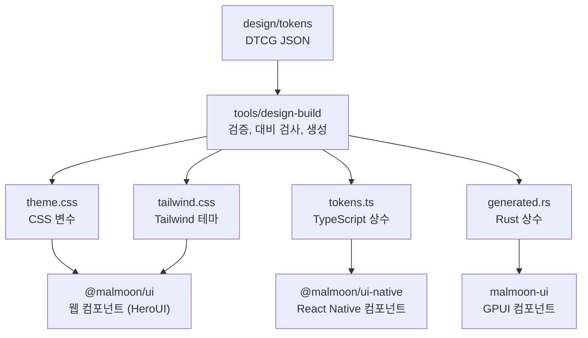
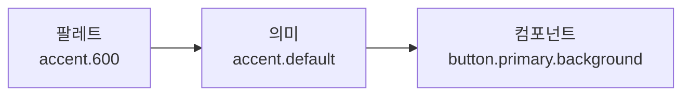

# 디자인 시스템

> 기준일 2026-11-13. 이 문서의 토큰, 생성기, 세 플랫폼의 컴포넌트는 저장소에 구현돼 있고 `mise run check`가 검증한다.
> 프롬프터 세트의 나머지 컴포넌트는 계획이다.

## 결론

Malmoon이 소유한 토큰 파일이 원천이고, 웹, 데스크톱, 모바일은 거기서 생성한 파일로 같은 컴포넌트를 각자 그린다.

- **공유하는 것은 컴포넌트 코드가 아니라 결정이다.** 토큰의 이름과 값, 컴포넌트의 종류와 선택지를 공유하고, 구현은 플랫폼마다 그 플랫폼의 방식으로 한다.
- **토큰은 세 층이다.** 원색 팔레트, 의미가 있는 색, 컴포넌트가 실제로 쓰는 색으로 나눈다. 화면 코드는 팔레트를 쓸 수 없다.
- **접근성 기준은 빌드가 지킨다.** 색 조합 82개의 대비를 토큰을 빌드할 때마다 두 색 모드에서 검사한다.
- **크기는 입력 장치를 따른다.** 마우스와 손가락의 컨트롤 높이가 다르다. 화면 너비가 아니라 입력 장치로 고른다.
- **웹은 HeroUI v3, 데스크톱은 GPUI Component, 모바일은 React Native 기본 요소 위에 만든다.** 앱은 디자인 시스템 패키지만 가져다 쓴다.

## 구조

생성된 파일은 저장소에 커밋한다. CI가 다시 생성해서 커밋된 것과 다르면 실패한다(`mise run check:generated`).

## 따른 기준

| 기준 | 여기서 지키는 방법 |
| --- | --- |
| 글자는 배경과 4.5:1 이상 (WCAG 2.2, 1.4.3) | 빌드의 대비 검사. 자리 표시 글자도 글자로 본다 |
| 컨트롤의 경계와 포커스 표시는 3:1 이상 (1.4.11) | 입력 칸 테두리와 포커스 색을 따로 두고 검사한다 |
| 색만으로 정보를 전하지 않는다 (1.4.1) | 배지는 글자가, 배너는 모양이 다른 표시가 뜻을 전한다. 오류는 테두리가 굵어지고 문구가 붙는다 |
| 누를 수 있는 영역은 24px 이상 (2.5.8), 터치는 iOS 44pt와 Android 48dp | 크기 토큰이 입력 장치별로 다르다. 터치는 48로 둘 다 만족한다 |
| 포커스 표시는 2px 이상 (2.4.13) | 포커스 두께와 간격을 토큰으로 둔다 |
| 글자 크기를 사용자가 키울 수 있다 (1.4.4) | 모바일은 시스템 글자 크기를 따르고, 컨트롤은 높이가 아니라 최소 높이를 쓴다 |
| 움직임을 줄이라는 설정을 따른다 | 스피너는 회전 대신 느린 깜빡임으로 바뀌고, 버튼 전환은 꺼진다 |

토큰을 세 층으로 나누는 방식은 Material Design 3(reference, system, component)과 GitHub Primer(base, functional, component)를 따랐다. 기준의 출처는 [출처](sources.md#디자인-시스템)에 있다.

## 토큰

### 원천 파일

| 파일 | 내용 |
| --- | --- |
| `palette.json` | 원색 계열 6개. 다른 토큰이 참조만 하고, 플랫폼 코드로는 생성되지 않는다 |
| `color.light.json`, `color.dark.json` | 의미 색과 컴포넌트 색. 모드마다 같은 이름이 있어야 한다 |
| `base.json` | 간격, 모서리, 테두리, 포커스, 글자, 움직임, 그림자, 오버레이 색 |
| `size.pointer.json`, `size.touch.json` | 입력 장치별 컨트롤 크기 |

형식은 DTCG 2025.10이다. 색 모드와 입력 장치는 파일을 나눠 표현한다. DTCG에는 이런 묶음을 기술하는 Resolver 모듈이 따로 있지만, 쓰는 도구가 아직 적어서 따르지 않았다. 색은 sRGB만 받는다. GPUI와 React Native가 넓은 색 영역을 그리지 못해서, 받으면 플랫폼마다 색이 달라진다.

### 색의 세 층

| 층 | 예 | 누가 쓰나 |
| --- | --- | --- |
| 팔레트 | `palette.accent.600` | 의미 색만 참조한다. 생성물에 없다 |
| 의미 | `text.secondary`, `border.strong`, `status.danger` | 화면과 컴포넌트 |
| 컴포넌트 | `button.primary.background-hover`, `field.border-invalid` | 그 컴포넌트의 세 플랫폼 구현 |

컴포넌트 층을 두는 이유는 "기본 버튼을 누르면 무슨 색인가"를 한 곳에서 정하기 위해서다. 이 층이 없으면 같은 결정을 플랫폼마다 코드로 다시 하게 되고, 거기서 어긋난다.

의미 색의 묶음은 다음과 같다.

| 묶음 | 토큰 | 쓰임 |
| --- | --- | --- |
| background | base, surface, raised, disabled | 페이지, 카드, 떠 있는 표면, 비활성 컨트롤 |
| text | primary, secondary, disabled, accent, on-accent, on-danger | 글자. `on-*`은 색이 있는 면 위의 글자 |
| border | default, strong, focus | 장식용 선, 컨트롤 경계(3:1), 포커스 |
| accent | default, hover, pressed, subtle | 화면의 주된 동작과 선택 상태 |
| control | default, hover, pressed | 중립 컨트롤의 면 |
| danger | default, hover, pressed | 되돌릴 수 없는 동작의 면 |
| status | danger, success, warning, info와 각각의 subtle | 상태를 알리는 글자와 그 옅은 배경 |
| data-path, overlay | | 제품 고유. 데이터 경로 배지와 프롬프터 패널 |

상태 색(hover, pressed)은 투명도를 겹쳐 만들지 않고 값으로 적는다. GPUI와 React Native에는 실행 중에 색을 섞는 수단이 없고, 값으로 적어야 대비를 빌드에서 검사할 수 있다.

어두운 모드는 밝은 모드를 뒤집은 것이 아니다. 떠 있는 표면은 그림자 대신 더 밝은 면으로 구분하고, 강조색 면은 흰 글자와 4.5:1이 되는 단계를 쓴다.

### 글자

화면은 크기가 아니라 역할을 고른다. 역할 하나가 크기, 굵기, 줄 높이, 자간을 함께 정한다.

| 역할 | 크기 / 줄 높이 / 굵기 | 쓰임 |
| --- | --- | --- |
| display | 28 / 1.25 / 700 | 화면에 하나. 지금 있는 곳의 이름 |
| title | 22 / 1.25 / 700 | 구역과 대화 상자의 제목 |
| heading | 18 / 1.4 / 600 | 카드 제목 |
| body, body-strong | 16 / 1.5 / 400, 600 | 본문과 본문 안의 강조 |
| label | 14 / 1.4 / 600 | 버튼과 입력 칸의 이름 |
| detail | 14 / 1.5 / 400 | 설명과 보조 문장 |
| footnote | 12 / 1.4 / 600 | 배지와 시각 표시 |
| caption | 20 / 1.25 / 600 | 실시간 자막 한 줄 |

- 본문은 16px다. 그보다 작은 입력 칸에 포커스가 가면 iOS Safari가 페이지를 확대한다고 널리 알려져 있다. 공식 문서에서는 확인하지 못했다.
- 가장 작은 크기는 12px다. 한글은 그 아래에서 획이 뭉개진다.
- 본문 줄 높이는 1.5다. 한글은 같은 크기의 라틴 글자보다 줄 간격이 더 필요하다.
- 줄은 어절 단위로 바꾼다. 웹은 `word-break: keep-all`, iOS는 `lineBreakStrategyIOS`, GPUI는 `wrap_words`로 한다.

Tailwind에는 역할만 유틸리티로 나간다(`text-mm-body`). 크기만 바꾸는 유틸리티는 일부러 만들지 않았다.

### 크기

| 토큰 | 마우스 | 터치 |
| --- | --- | --- |
| `size.control.sm` | 28 | 40 |
| `size.control.md` | 36 | 48 |
| `size.control.lg` | 44 | 56 |
| `size.target-min` | 24 | 48 |

웹은 `@media (pointer: coarse)`로 두 값을 바꾼다. 화면 너비로 고르지 않는 이유는, 좁은 노트북 창은 여전히 마우스로 쓰고 큰 태블릿은 손가락으로 쓰기 때문이다. 데스크톱 앱은 마우스 값을, 모바일 앱은 터치 값을 쓴다.

작은 버튼도 누를 수 있는 영역은 `target-min`보다 작지 않다. 모바일의 작은 버튼(40)은 보이는 크기 밖으로 영역을 넓힌다.

### 그 밖

| 묶음 | 값 | 규칙 |
| --- | --- | --- |
| space | 4, 8, 12, 16, 24, 32, 48 | 4px 격자. 이름이 4의 배수다 |
| radius | sm 6, md 10, lg 16, full | 컨트롤 안의 작은 부품, 컨트롤, 담는 면 순서다 |
| border.width | thin 1, thick 2 | 굵은 선은 색에만 기대면 안 되는 상태에 쓴다 |
| focus | width 2, offset 2 | 포커스 고리와 컨트롤 사이를 띄워, 컨트롤의 면 색과 섞이지 않게 한다 |
| motion.duration | fast 120, normal 200, slow 320 | 누름 반응, 나타남, 큰 면의 이동 |
| motion.easing | standard, enter, exit | 이동, 들어옴, 나감 |
| shadow | raised, overlay | 어두운 모드에서는 그림자가 거의 보이지 않아 면 색이 높이를 나타낸다 |

### 빌드가 거부하는 것

- sRGB가 아닌 색, 16진 표기와 성분이 다른 색
- px가 아닌 길이, ms가 아닌 시간, 안쪽 그림자
- 한쪽 색 모드나 한쪽 입력 장치에만 있는 토큰
- 기준보다 낮은 대비. 어떤 조합이 어느 모드에서 몇 대 1인지 알려 준다

## 컴포넌트

### 계약

세 플랫폼의 컴포넌트는 이름, 변형, 크기, 톤이 같다.

| 컴포넌트 | 선택지 | 규칙 |
| --- | --- | --- |
| Button | variant: primary, secondary, ghost, danger. size: sm, md, lg. disabled, loading | primary는 화면에 하나다. 레이블은 동사로 쓴다 |
| TextField | label, description, error, disabled | 레이블은 항상 보인다. 자리 표시 글자는 레이블이 아니다 |
| Text | variant: 글자 역할 9개. tone: primary, secondary, accent, danger, success, warning | 요소는 문서 구조에 맞게 고르고, 모양은 variant로 정한다 |
| Badge | tone: neutral, accent, success, warning, danger. dot | 글자가 뜻을 전하고 색은 거든다 |
| Banner | tone: info, success, warning, danger. title | 톤마다 표시 모양이 다르다. 경고와 오류는 화면 낭독기가 바로 읽는다 |
| Card | title, description, actions | 그림자가 아니라 테두리로 구분한다 |
| Divider, Spinner | | 스피너는 이름이 있을 때만 낭독된다 |

상태별 규칙은 다음과 같다.

| 상태 | 규칙 |
| --- | --- |
| hover, pressed | 색이 한 단계씩 짙어진다. 터치에는 hover가 없다 |
| focus | 키보드로 옮겼을 때만 고리를 그린다 |
| disabled | 흐리게 하지 않고 비활성 색으로 바꾼다. 색이 있는 면을 흐리게 하면 여전히 누를 수 있어 보인다 |
| loading | 레이블을 남겨 너비가 변하지 않게 하고, 색도 그대로 둔다. 받아들여진 동작이지 쓸 수 없는 동작이 아니다 |
| invalid | 테두리가 붉어지면서 굵어지고, 설명 자리에 오류 문구가 온다. 값을 고치기 시작하면 오류를 지운다 |

마지막 줄의 "고치기 시작하면 지운다"는 실제로 겪은 문제에서 나왔다. 웹에서 오류 상태인 입력 칸은 폼 제출을 막기 때문에, 오류를 남겨 두면 값을 고쳐도 다시 제출할 수 없다.

### 플랫폼별 구현

| | 웹 | 데스크톱 | 모바일 |
| --- | --- | --- | --- |
| 패키지 | `@malmoon/ui` | `malmoon-ui` | `@malmoon/ui-native` |
| 바탕 | HeroUI v3 (React Aria) | GPUI Component | React Native 기본 요소 |
| 토큰을 받는 형태 | CSS 변수와 Tailwind 테마 | Rust 상수 | TypeScript 상수 |
| 크기 | 입력 장치에 따라 바뀜 | 마우스 | 터치 |
| 디자인 프리뷰 | `/design` | `malmoon --design` | `/design` |

### 디자인 프리뷰

토큰과 컴포넌트를 한 화면에서 둘러보는 경로가 플랫폼마다 있다. 세 곳 모두 색, 글자, 간격과 모서리와 크기, 버튼, 입력, 배지, 배너, 카드를 같은 순서로 보여 주므로 나란히 놓고 비교할 수 있다. 색 목록은 생성된 토큰에서 읽으므로 토큰을 추가하면 따로 고치지 않아도 나타난다.

| | 여는 방법 | 들어가는 길 | 밝은 화면과 어두운 화면 |
| --- | --- | --- | --- |
| 웹 | `mise run //web:dev` 뒤 `http://localhost:5173/design` | 앱 머리글의 "디자인 시스템" 링크 | 시스템 설정을 따른다. `?theme=light`와 `?theme=dark`로 고정한다 |
| 데스크톱 | `mise run //desktop:design` 또는 `malmoon --design` | 실행 인자 | 어둡게 열린다. 창의 버튼으로 바꾸고, `--light`로 밝게 연다 |
| 모바일 | 앱의 `/design` 화면 | 개발 빌드의 첫 화면 아래 "디자인 시스템 보기" | 시스템 설정을 따른다 |

프리뷰는 로그인 없이 열리고 게이트웨이를 부르지 않는다. 웹에서는 `/design`으로 들어올 때만 프리뷰 코드를 내려받는다. 웹을 정적 파일로 배포할 때는 `/design` 요청에도 `index.html`을 돌려주도록 설정해야 한다.

**웹.** `heroui-theme.css`가 HeroUI의 테마 변수를 토큰에 연결하고, `components.css`가 HeroUI의 버튼과 입력 칸에 토큰의 크기와 상태 색을 입힌다. HeroUI의 이름을 아는 곳은 이 두 파일뿐이다. 동작이 필요한 Button과 TextField만 HeroUI를 감싸고, 나머지는 Tailwind 유틸리티로 직접 그린다. 감싸지 않은 HeroUI 컴포넌트를 쓰더라도 테마 변수를 통해 같은 색과 모서리를 받는다.

**데스크톱.** `malmoon_ui::set_mode`가 GPUI Component의 테마에 토큰을 입힌다. `button`은 GPUI Component의 버튼에 변형과 높이를 정해 돌려주고, Badge, Banner, TextField, `card`, `divider`, `text`는 직접 만든다. GPUI Component는 모든 창의 바닥에 테마 배경색을 칠하는데, 이 색이 불투명하면 오버레이의 블러 배경이 가려지므로 투명으로 바꾸고 표면마다 배경을 직접 칠한다.

**모바일.** `Pressable`과 `TextInput` 위에 직접 만든다. UI 키트는 쓰지 않는다. 지금 필요한 컴포넌트 수로는 의존성 하나를 들이는 값보다 직접 만드는 값이 작다. 글자는 시스템 글자 크기 설정을 따른다.

플랫폼마다 다른 점은 다음과 같다.

| 항목 | 차이 |
| --- | --- |
| 비활성과 진행 중인 버튼 | 웹과 모바일은 색을 바꾸고, 데스크톱은 GPUI Component가 흐리게 한다 |
| 오류인 입력 칸 | 웹과 모바일은 테두리가 굵어지고, 데스크톱은 바깥에 테두리를 하나 더 두른다 |
| 배너의 표시 | 웹은 도형 아이콘, 데스크톱과 모바일은 원 안의 글자다 |
| 글꼴 | Pretendard 파일을 아직 싣지 않아 세 플랫폼 모두 시스템 한글 글꼴로 그린다 |

### 프롬프터 세트

제품의 핵심 화면을 이루는 컴포넌트다. 숫자는 [로드맵](03-product-plan.md#로드맵)의 단계다.

| 컴포넌트 | 역할 | 데스크톱 | 웹 | 모바일 |
| --- | --- | --- | --- | --- |
| CaptionStream | 실시간 자막. 초안과 확정 상태, 불확실 단어 표시 | 1 | 2 | 4 |
| TopicHeader | 현재 주제와 지금까지의 결정 | 1 | 2 | 4 |
| ReplyCard | 답변 카드와 근거 표시 | 1 | 2 | 4 |
| IntentChips | 동의, 반대, 확인, 질문 | 1 | 2 | 4 |
| AskBar | 질문과 번역 입력창 | 1 | 2 | 4 |
| SessionControls | 시작, 일시정지, 종료, 데이터 경로 배지 | 1 | 2 | 4 |
| TranscriptView | 이중 언어 대화록 | 1 | 3 | 4 |
| HandoffSheet | 보조 화면 연결 (QR) | 2 | 2 | 4 |
| CoachingCard | 문장별 코칭 | 3 | 3 | 4 |

지금은 CaptionStream의 최소형이 세 플랫폼에 있다. 초안과 확정 상태, 번역을 표시하고, 불확실 단어 표시는 없다.

## 일관성 검증

| 무엇을 | 어떻게 | 상태 |
| --- | --- | --- |
| 토큰 값 | 생성된 파일을 커밋하고 CI가 다시 생성해 비교한다 | 구현 |
| 색 대비 | 토큰 빌드가 조합마다, 두 모드에서 검사한다 | 구현 |
| 컴포넌트의 선택지 | 세 플랫폼의 타입을 사람이 맞춘다. 한 곳에서 생성하지 않는다 | 수동 |
| 모양 | 플랫폼마다 디자인 프리뷰를 띄워 눈으로 본다. 기준 이미지와 자동으로 비교하지 않는다 | 수동 |

## 검토하고 택하지 않은 것

| 안 | 택하지 않은 이유 |
| --- | --- |
| Astryx를 기준으로 삼기 | 베타이고 1~3일마다 릴리스가 나온다. 네이티브 패키지는 실험 단계이고 React Native 바인딩이 없다. 토큰 211개를 gpui-component 테마에 손실 없이 넣을 수 있는지도 확인되지 않았다 |
| HeroUI Native와 Uniwind (모바일) | 지금 필요한 컴포넌트는 직접 만드는 편이 작다. 화면이 늘어 날짜 선택기나 시트가 필요해지면 다시 본다 |
| shadcn/ui와 React Native Reusables | 모바일 쪽 유지보수 신호가 약하고, 관리 콘솔용 표를 따로 붙여야 한다. 차선으로 남긴다 |
| Tamagui, gluestack-ui | 1년 안에 메이저 버전이 두세 번 올랐다 |
| Expo Router와 react-native-web으로 웹과 모바일을 한 앱으로 | 웹 범위가 DOM에 유리하고, react-native-web의 개발 활동이 줄었다 |

토큰을 Malmoon이 소유하므로, 웹 UI 라이브러리를 바꾸는 비용은 연결 파일과 컴포넌트 사용처에 한정된다.

## 위험과 미확인 항목

| 항목 | 내용 | 대응 |
| --- | --- | --- |
| HeroUI의 클래스 이름 | `components.css`가 HeroUI의 클래스와 컴포넌트 변수에 기댄다. HeroUI가 바꾸면 크기와 상태 색이 기본값으로 돌아간다 | 버전을 올릴 때 디자인 프리뷰로 확인한다. 깨져도 색과 모서리는 테마 변수로 남는다 |
| gpui-component의 변동 | 0.x이고 매주 릴리스가 나온다 | 정확한 버전으로 고정하고 `malmoon-ui`로 감싼다 |
| 모양의 자동 비교 | 없다. 플랫폼 사이의 차이는 디자인 프리뷰를 봐야 안다 | 컴포넌트가 늘면 스크린샷 비교를 도입한다 |
| 모바일 | iOS 시뮬레이터에서 디자인 프리뷰를 두 모드로, 로그인 화면을 어두운 모드로 봤다. Android와 실제 기기는 보지 않았다 | 4단계 착수 전에 확인한다 |
| 데스크톱의 접근성 | 화면 낭독기로 확인하지 않았다 | 1단계에서 VoiceOver로 확인한다 |
| Android 한국어 줄바꿈 | 어절 단위 옵션이 없다 | 4단계에서 자체 분절을 검토한다 |
| 아이콘과 문자열 | 아이콘 세트와 다국어 문자열 관리는 정하지 않았다 | 1단계에서 정한다 |
