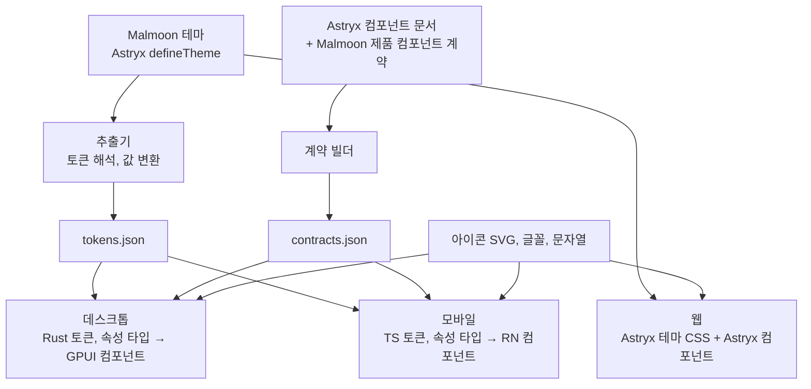

# 디자인 시스템 아키텍처

> 기준일 2026-11-12. Astryx는 커밋 `55b9032`(core 0.7.15) 기준으로 소스를 읽고 판단했다. 실행해 보지는 않았다.

## 결론

[Astryx](https://github.com/meta/astryx)를 기준으로 세 플랫폼을 묶을 수 있다.
웹은 Astryx를 그대로 쓰고, 데스크톱(GPUI)과 모바일(React Native)은 Astryx의 테마와 컴포넌트 계약에서 코드를 생성해 맞춘다.

- **공유하는 것은 컴포넌트 코드가 아니라 결정이다.** 토큰 이름과 값, 컴포넌트의 속성 이름과 선택지, 아이콘 이름, 문자열을 공유한다. Astryx도 같은 원칙을 명시한다: "Web and native share contracts and logic, not components."
- **선례가 저장소 안에 있다.** Astryx의 실험 패키지 `packages/native`가 테마와 컴포넌트 문서에서 Swift 코드를 생성한다. Malmoon은 같은 구조로 Rust와 React Native 생성기를 만든다.
- **웹 프레임워크는 React로 확정된다.** Astryx가 React 19 전용이기 때문이다. SolidJS는 선택지에서 빠진다.
- **GPUI 바인딩은 Malmoon이 끝까지 소유한다.** Astryx는 필수 런타임을 플랫폼 SDK와 Meta 프로젝트로 제한하므로, 상위 저장소가 GPUI를 지원할 일은 없다.

## 누가 무엇을 맡나

| 플랫폼 | Astryx에서 그대로 가져오는 것 | Malmoon이 생성하는 것 | Malmoon이 직접 만드는 것 |
| --- | --- | --- | --- |
| 웹 (React) | 컴포넌트 150여 개, 테마 정의와 빌드, 문자열 | Malmoon 테마 CSS | 글꼴 로딩, 제품 전용 컴포넌트 |
| 데스크톱 (GPUI) | 토큰 어휘와 해석기, 컴포넌트 문서, 아이콘 이름, 문자열 | Rust 토큰, Rust 속성 타입 | 모든 컴포넌트 구현, 모션, 반투명 재질 |
| 모바일 (React Native) | 데스크톱과 같은 입력 | TypeScript 토큰과 속성 타입 | 컴포넌트 구현 (공식 패키지가 나올 때까지) |

## 구조

핵심은 가운데의 두 파일이다. `tokens.json`과 `contracts.json`은 Malmoon이 소유하는 중간 산출물이다.
Astryx 내부가 바뀌면 추출기만 고치면 되고, Rust와 React Native 생성기는 영향을 받지 않는다.

## 토큰

### 어휘는 Astryx 것을 쓴다

Astryx 코어 토큰은 211개이고 의미 단위 한 계층이다. 색 98, 글자 크기 체계 54, 간격 15, 지속 시간 10, 그림자 8, 모서리 7개 등이다.
색 이름은 `--color-<text|icon|background|border>-<역할>` 문법을 따른다. Malmoon은 이 이름을 세 플랫폼에서 그대로 쓴다.

테마는 Astryx의 `defineTheme`으로 한 곳에서 작성한다. 기본 테마(neutral)를 확장하고 강조색, 글꼴, 모서리, 모션만 바꾼다.

### 값은 플랫폼 형식으로 변환한다

Astryx 테마 값은 CSS 문자열이다(`light-dark()`, `oklch()`, `color-mix()`, `calc()`, rem).
추출기가 이를 해석해 플랫폼 중립 값으로 바꾸고, 생성기가 플랫폼 타입으로 옮긴다.

| 종류 | `tokens.json` | 웹 | 데스크톱 (GPUI) | 모바일 (RN) |
| --- | --- | --- | --- | --- |
| 색 | sRGB 16진수, 라이트와 다크 두 값 | Astryx CSS 변수 그대로 | `Hsla` 상수 | 16진수 문자열 |
| 길이 | px (1rem은 16px) | rem, px | `px()` | 숫자 (dp) |
| 글자 | 크기, 굵기, 줄 높이 배수, 글꼴 목록 | CSS 변수 | 글자 스타일 구조체 | 스타일 객체 |
| 그림자 | 층별 x, y, 흐림, 퍼짐, 색 | CSS 변수 | `BoxShadow` | `boxShadow` |
| 모션 | 밀리초, 3차 베지어 좌표 | CSS 변수 | `Duration`과 이징 함수 | Reanimated 이징 |

- `tokens.json`은 DTCG 형식(2025.10 안정판)으로 쓴다. 표준 도구로 대비 검사와 Figma 연동을 붙일 수 있다.
- 값 변환은 Astryx의 `css-values.mjs`를 고정 커밋에서 가져와 쓴다. 의존성이 없는 1,135줄 파일이고 출력이 Swift에 묶여 있지 않다.
- 표현할 수 없는 값은 빌드를 실패시킨다. GPUI는 sRGB 색과 바깥 그림자만 다루므로, 테마는 sRGB 범위 안에서 작성한다.
- 모션 토큰은 Astryx의 Swift 생성기가 내보내지 않는다. 밀리초와 베지어 해석은 Malmoon이 추가한다.

### 제품 전용 토큰

Astryx 어휘에 없는 것만 추가한다. Astryx 테마의 로컬 토큰 계층에 정의해 웹에서도 CSS 변수로 나오게 한다.

| 토큰 | 용도 |
| --- | --- |
| 초안 자막 글자색 | 아직 확정되지 않은 자막 |
| 불확실 표시색 | 인식 신뢰도가 낮은 단어 |
| 데이터 경로 색 세 가지 | 표준, 무보존, 기밀 배지 |
| 오버레이 표면 | 반투명 프롬프터 배경 |
| 자막 확정 모션 | 초안이 확정본으로 바뀌는 전환 |

### 모드

- **라이트와 다크.** Astryx가 지원하는 두 모드를 그대로 쓴다.
- **오버레이.** 프롬프터는 어떤 화면 위에서도 읽혀야 한다. 다크 토큰과 반투명 재질을 기본으로 한다.
- **재질.** 반투명은 토큰 값이 아니라 표면별 의도(불투명, 반투명)로 선언하고 플랫폼이 구현한다. 웹은 배경 흐림, GPUI는 창 배경 블러, React Native는 블러 뷰다.
- **모바일 크기.** Astryx 테마의 터치 기기용 조정 규칙을 적용한 값을 따로 추출한다.

## 컴포넌트 계약

계약은 컴포넌트의 플랫폼 중립 정의다. 이름, 속성과 타입, 선택지, 콜백, 내용 슬롯을 담는다.

- **Astryx 컴포넌트.** Astryx의 계약 빌더가 컴포넌트 문서를 읽어 계약을 만든다. `className`, DOM 이벤트, `aria-*` 같은 웹 전용 속성은 이유와 함께 분리된다. 현재 18개 컴포넌트에 계약이 있다.
- **Malmoon 제품 컴포넌트.** Astryx에 없는 컴포넌트는 같은 형식으로 계약을 직접 쓴다.
- **보완할 점.** Astryx 계약에는 기본값이 빠져 있다. 컴포넌트 문서에서 기본값을 읽어 `contracts.json`에 채운다.

`contracts.json`에서 두 가지를 생성한다.

| 대상 | 생성물 | 규칙 |
| --- | --- | --- |
| Rust | 선택지 `enum`, 선택 속성 `Option<T>`, 아이콘 이름 타입 | Rust 예약어 검사를 추가한다 |
| React Native | 속성 타입 선언 | iOS와 Android 전용 속성을 조건별로 나눈다 |

선택지 이름이 생성된 타입으로 고정되므로, 플랫폼마다 `variant` 값이 달라지는 일은 컴파일 단계에서 막힌다.

## 플랫폼별 구현

### 웹

- Astryx 컴포넌트와 Malmoon 테마를 그대로 쓴다. 관리 콘솔은 Astryx의 표, 설정, 대시보드 템플릿에서 시작한다.
- 제품 전용 컴포넌트는 Astryx CSS 변수를 쓰는 일반 CSS로 만든다.
- 실시간 자막은 줄 단위로 구독하게 만들어, 초당 수십 번의 갱신이 화면 전체를 다시 그리지 않게 한다.

### 데스크톱 (GPUI)

- 동작(포커스, 키보드, 입력기, 팝오버)은 gpui-component에 맡기고, 모양은 Malmoon 토큰으로 입힌다. gpui-component의 테마 구조체에 Astryx 토큰을 대응시키는 코드를 생성한다.
- 그 위에 `malmoon-ui` 크레이트가 계약에 맞춘 API와 제품 전용 컴포넌트를 제공한다.
- 한국어 어절 단위 줄바꿈은 GPUI에 없다. 분절 로직을 `malmoon-core`에 두고 자막 줄을 미리 끊는다.

### 모바일 (React Native)

- 4단계 전까지는 토큰과 타입 생성만 준비하고 컴포넌트는 만들지 않는다.
- Astryx에 React Native 패키지 명세(AST-112)가 초안으로 올라와 있다. 코드와 일정은 없다. 4단계 착수 시점에 공식 패키지를 채택할지, 직접 만들지 정한다.
- 계약 이름을 Astryx와 맞춰 두면 공식 패키지로 옮길 때 드는 비용이 작다.

## 컴포넌트 범위

### 기본 컴포넌트

웹은 Astryx 전체를 쓴다. 데스크톱과 모바일은 계약이 있는 것 중 필요한 것만 구현한다.

Button, Text, Heading, TextInput, Switch, Selector, Card, Divider, Badge, Icon, HStack, VStack, ProgressBar, Item, ListItem, Avatar

### 프롬프터 세트

제품의 핵심 화면을 이루는 전용 컴포넌트다. 숫자는 [로드맵](03-product-plan.md#로드맵)의 단계다.

| 컴포넌트 | 역할 | 데스크톱 | 웹 | 모바일 |
| --- | --- | --- | --- | --- |
| CaptionStream | 실시간 자막. 초안과 확정 상태, 불확실 단어 표시 | 1 | 2 | 4 |
| TopicHeader | 현재 주제와 지금까지의 결정 | 1 | 2 | 4 |
| ReplyCard | 답변 카드와 근거 표시 | 1 | 2 | 4 |
| IntentChips | 동의, 반대, 확인, 질문 | 1 | 2 | 4 |
| AskBar | 질문과 번역 입력창 | 1 | 2 | 4 |
| SessionControls | 시작, 일시정지, 종료, 데이터 경로 배지 | 1 | 2 | 4 |
| TranscriptView | 이중 언어 대화록 | 1 | 3 | 4 |
| HandoffSheet | 보조 화면 연결 (QR) | 2 | 2 | 4 |
| CoachingCard | 문장별 코칭 | 3 | 3 | 4 |

## 글꼴, 아이콘, 문자열

| 자산 | 원천 | 웹 | 데스크톱 | 모바일 |
| --- | --- | --- | --- | --- |
| 글꼴 | Pretendard (OFL). 일본어는 Pretendard JP | 자체 호스팅, 부분 집합 | 굵기별 정적 파일을 앱에 싣는다 | 굵기별 정적 파일 |
| 아이콘 | 단색 SVG 한 벌, Astryx 아이콘 이름 | Astryx 아이콘 슬롯 | 앱에 내장, 이름 `enum` 생성 | react-native-svg |
| 문자열 | Astryx 로캘 파일 (ICU MessageFormat) | Astryx 그대로 | 같은 파일을 읽는다 | 같은 파일을 읽는다 |

- GPUI에서 가변 글꼴의 굵기 축이 무시되는 이슈가 있어 정적 파일을 쓴다.
- Astryx의 한국어 문자열은 642개 중 365개만 번역돼 있다. 나머지는 Malmoon이 채운다.
- 한국어 줄바꿈은 플랫폼마다 다르다. 웹은 `word-break: keep-all`, iOS는 `hangul-word` 전략, Android와 GPUI는 자체 분절이 필요하다.

## 일관성 검증

| 무엇을 | 어떻게 |
| --- | --- |
| 토큰 값 | 생성된 파일을 커밋하고, CI가 다시 생성해 차이가 있으면 실패시킨다. 웹 CSS와 `tokens.json`도 비교한다 |
| 컴포넌트 API | 생성된 타입으로 컴파일 단계에서 강제한다 |
| 색 대비 | 글자와 배경 쌍을 빌드 때 WCAG 2 기준으로 검사한다. 오버레이는 밝은 화면 위의 경우를 포함한다 |
| 모양 | 플랫폼마다 같은 시나리오의 스크린샷 기준 이미지를 둔다. 플랫폼 간 비교는 나란히 놓고 사람이 본다 |

스크린샷 도구는 웹이 Storybook과 Playwright, 모바일이 Storybook과 Maestro다. GPUI는 성숙한 도구가 없어 자체 갤러리 앱으로 시작한다.

## 단계별 도입

| 단계 | 디자인 시스템 작업 |
| --- | --- |
| 0. 검증 | Malmoon 테마 작성, 추출기와 Rust 생성기 시제품, GPUI 오버레이에서 토큰 적용 확인 |
| 1. 동등 MVP | 데스크톱 기본 컴포넌트와 프롬프터 세트, 계약 생성기, 최소 웹(Astryx 그대로) |
| 2. 차별화 | 웹 보조 화면용 프롬프터 세트, 데스크톱과 웹의 스크린샷 비교 |
| 3. 팀과 보안 | Astryx 템플릿 기반 관리 콘솔 |
| 4. 확장 | React Native 바인딩 (공식 패키지 또는 자체) |

## 위험과 대응

| 위험 | 내용 | 대응 |
| --- | --- | --- |
| Astryx의 잦은 변경 | 베타 단계이고 3~5주마다 호환성이 깨지는 릴리스가 나온다 | 버전을 정확히 고정하고 월 단위로 올린다. 중간 산출물이 생성기를 보호한다 |
| 실험 패키지 의존 | 네이티브 패키지는 카나리 전용이고 생성 스크립트는 npm에 없다 | 필요한 파일만 고정 커밋에서 가져와 저장소에 둔다 (MIT, 출처 표기) |
| 계약 범위 | 계약이 있는 컴포넌트가 18개뿐이다 | 필요한 컴포넌트의 계약을 직접 추가한다 |
| GPUI 구현 비용 | 컴포넌트를 모두 직접 만들어야 한다 | 범위를 기본 16개와 프롬프터 세트로 제한하고 gpui-component를 기반으로 쓴다 |
| 공식 React Native 패키지와의 충돌 | 나중에 나오면 자체 바인딩과 겹친다 | 4단계까지 컴포넌트 구현을 미룬다 |
| 표현 손실 | Display P3 색과 안쪽 그림자는 GPUI에서 표현되지 않는다 | 생성기의 엄격 모드로 빌드에서 걸러낸다 |

## 확인이 필요한 항목

0단계 시제품에서 다음을 실제로 돌려 확인한다. 이 문서는 소스를 읽고 쓴 것이고 실행 결과가 아니다.

- Astryx의 토큰 해석기가 React 없이 Node 스크립트에서 깨끗하게 실행되는지
- 로컬 토큰 계층이 제품 전용 토큰을 담기에 맞는지
- 터치 기기용 조정 규칙을 적용한 값을 해석기로 뽑을 수 있는지
- gpui-component의 테마 구조체가 Astryx 토큰을 손실 없이 받는지
